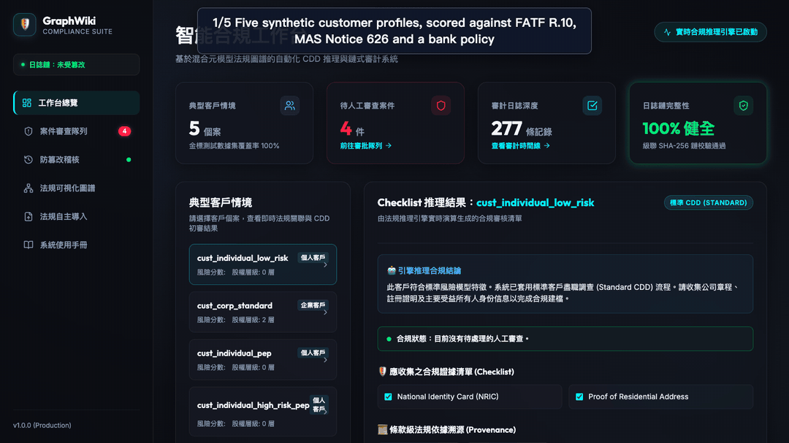
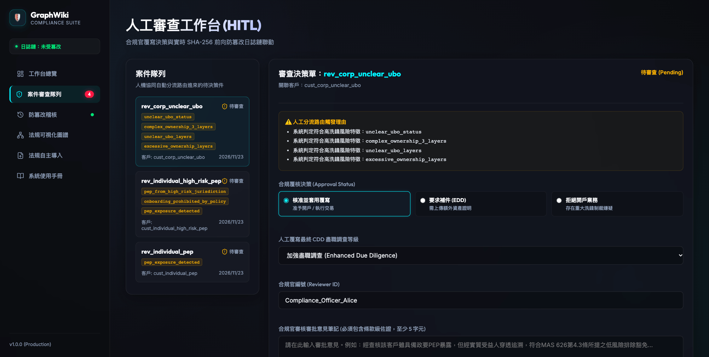
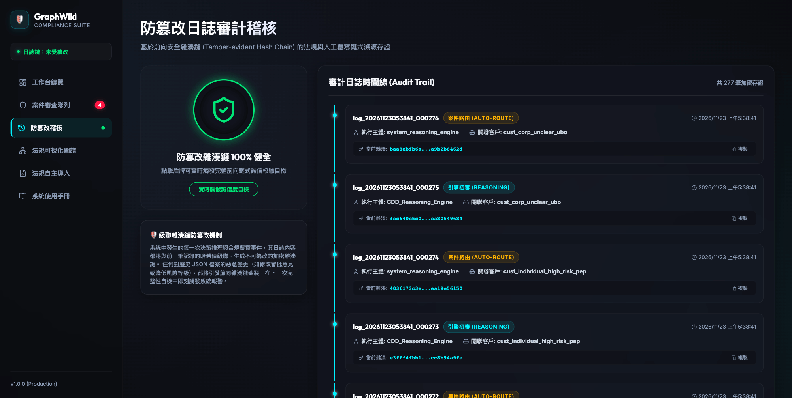
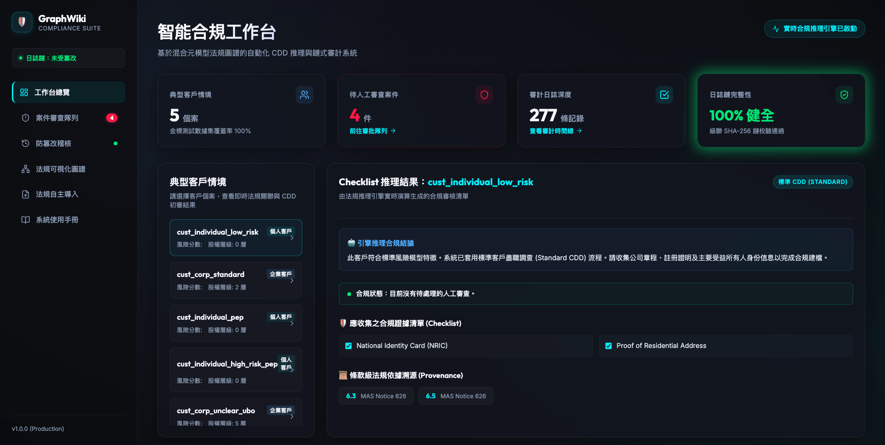
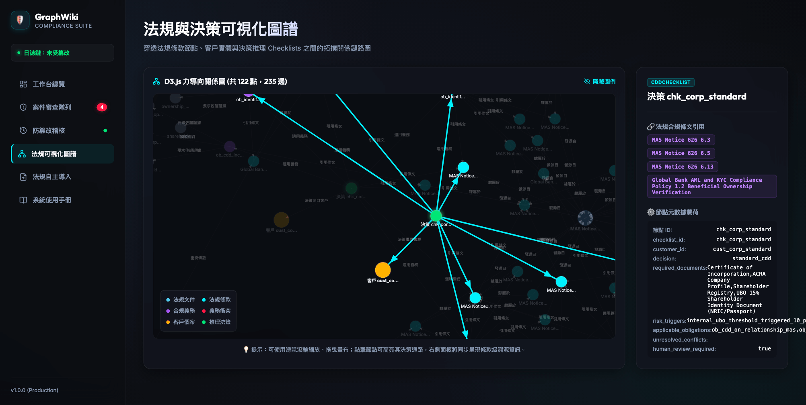
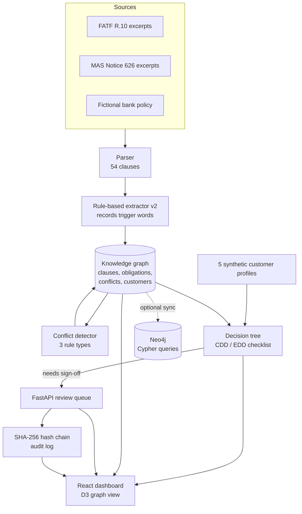
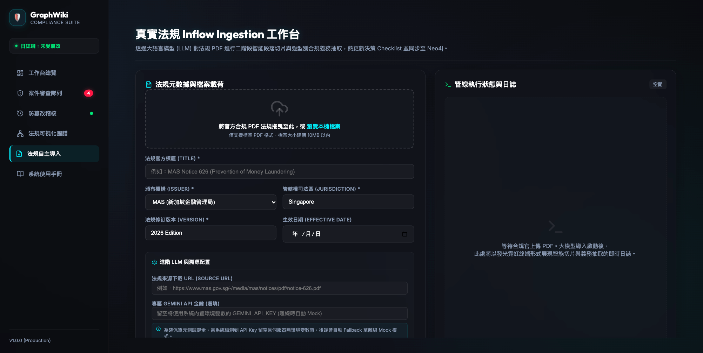

# CDD-GraphWiki

[](https://github.com/DancinAndrew/CDD-GraphWiki/actions/workflows/ci.yml)



**An explainable anti-money laundering (AML) knowledge graph that turns regulation text into customer due diligence (CDD) checklists that cite their sources, and sends risky cases to a human reviewer.** Compliance teams check customers against requirements scattered across regulations and internal policy; this proof of concept shows how those requirements can be extracted, linked and audited instead of answered by a black-box chat.

Individual final project for the IT Risk Management course at National Central University (May–June 2026), extended in November 2026. 繁體中文詳細說明見 [README.zh-TW.md](README.zh-TW.md).

## What it does

- **Builds a knowledge graph from regulation text.** Parses 54 clauses from FATF Recommendation 10, Singapore MAS Notice 626 and a fictional bank policy into a schema-validated graph of obligations, conflicts and customer contexts.
- **Flags conflicts between sources.** Finds three, such as a 25% versus 10% beneficial ownership threshold.
- **Generates checklists that cite their clauses.** Produces CDD and enhanced due diligence (EDD) checklists for five synthetic customers and routes 4 of them to a FastAPI review queue for human sign-off.
- **Shows why.** Every rule decision records the words that triggered it; deletion tests in the style of ERASER check that those words are what the decision actually used. A D3 graph view traces each checklist back to its clauses.
- **Keeps an audit trail.** Reasoning and review events go into a SHA-256 hash chain audit log, so a later edit to any record is detected when the chain is verified.

| Review queue | Audit trail |
| --- | --- |
|  |  |
| **Dashboard** | **Knowledge graph view** |
|  |  |

## Architecture



A detailed phase-by-phase diagram is in [`docs/assets/phase_1_10_architecture.png`](docs/assets/phase_1_10_architecture.png).

## Quick start

Requires Docker. No API keys are needed for the dashboard, the rule-based pipeline or the tests.

```bash
git clone https://github.com/DancinAndrew/CDD-GraphWiki.git
cd CDD-GraphWiki
cp .env.example .env
docker compose -f deployment/docker-compose.yml up --build
```

Open the dashboard at `http://localhost:3000` and the API docs at `http://localhost:8000/docs`. The running backend appends reasoning events to `data/processed/audit_log.json`.

Without Docker (Python 3.12):

```bash
pip install -r backend/requirements.txt
PYTHONPATH=backend python -m src.pipeline      # rebuilds data/processed and prints every number below
PYTHONPATH=backend pytest backend/tests         # 244 tests
```

`PYTHONPATH=backend python -m src.heldout.evaluate`, `PYTHONPATH=backend python -m src.heldout.llm_compare score` and `PYTHONPATH=backend python -m src.heldout.llm_faithfulness score` recompute the held-out scores and deletion tests from cached answers, and `PYTHONPATH=backend python -m src.heldout.label_review` rebuilds the label review.

## Results

| Result | Evidence |
| --- | --- |
| 54 clauses with text, plus 5 section-heading records (59 records: FATF 17, MAS 28, fictional bank policy 14) | [`data/processed/clauses.yaml`](data/processed/clauses.yaml), parsed from [`data/sources/`](data/sources/) |
| 3 conflicts: ownership 25% vs 10%, occasional transactions USD/EUR 15,000 vs S$20,000, PEPs allowed vs prohibited | [`data/processed/conflicts.yaml`](data/processed/conflicts.yaml) |
| 5 checklists for 5 synthetic profiles, 4 routed to human review | [`data/processed/checklists.yaml`](data/processed/checklists.yaml) |
| 13/13 obligations in the development gold set found, each with the right anchor clause, jurisdiction and full set of source clauses (the rules were written against this set, so this shows coverage, not generalisation) | [`data/processed/evaluation_report.txt`](data/processed/evaluation_report.txt) |
| **Unseen UK text** (Part 3 of the UK Money Laundering Regulations 2017, 137 paragraphs, labelled after the rules were frozen): the rebuilt rules (v2) found 15 of 32 labelled obligations at precision 0.88; the first rules (v1) found none, and at most 3 when told to treat the text as FATF or MAS | [`rules_v2_report.txt`](data/heldout/results/uk_mlr_2017/rules_v2_report.txt), [`rules_v1_report.txt`](data/heldout/results/uk_mlr_2017/rules_v1_report.txt) |
| A local open-weight LLM (qwen3.5:9b) given the same written guideline found 26 of 32 on the same UK text, at precision 0.43 | [`llm_qwen3_5_9b_report.txt`](data/heldout/results/uk_mlr_2017/llm_qwen3_5_9b_report.txt) |
| Deletion tests on the UK text: the words each rule recorded passed both tests for all 30 of its labels | [`rules_v2_faithfulness.txt`](data/heldout/results/uk_mlr_2017/rules_v2_faithfulness.txt) |
| The same tests on the LLM's own quoted evidence (a second prompt asks it to quote the words behind each label): both passed for 53 of 161; its quotes cover 76% of the clause text | [`llm_qwen3_5_9b_evidence_faithfulness.txt`](data/heldout/results/uk_mlr_2017/llm_qwen3_5_9b_evidence_faithfulness.txt) |
| Held-out MAS Notice 626 (157 paragraphs, labels committed before v1 ran): v1 1/18 (precision 0.14); v2 18/18 (0.95, but v2 was designed after studying these errors); LLM 16/18 (0.40) | [`data/heldout/results/mas_notice_626/`](data/heldout/results/mas_notice_626/) |
| Rule explanations pass both deletion tests for 81/81 held-out labels (51 MAS, 30 UK) and 42/46 development labels; cited words cover about 20% of the clause text they touch | [`explanation_faithfulness.txt`](data/processed/explanation_faithfulness.txt) |
| Confidence = measured precision of each rule type on the unseen UK text (cdd_triggers 8/9, verify_customer 3/3, identify_ubo 3/4, prohibit_anonymous 1/1; PEP EDD and CDD-incomplete found 0 of 4 and 0 of 2, so no precision) | `rule_reliability` in [`summary.json`](data/processed/summary.json) |
| All numbers in one file | [`data/processed/summary.json`](data/processed/summary.json) |

<details>
<summary>How the held-out tests and explanations work</summary>

**Held-out tests:** the first rules (v1) matched every development obligation but found only 1 of 18 obligations in the 157 other paragraphs of the official MAS Notice 626, labelled and committed before the rules were run. The rules were rebuilt (v2) around how a requirement is phrased: which verb a modal governs, permissions and exemptions, who must be identified, and how list items relate to their lead-in. v2 was frozen (commit `98332e9`) before a second regulation was fetched and labelled (commit `5a89252`): Part 3 of the UK Money Laundering Regulations 2017, which neither version had seen. The rules miss half and the LLM over-labels, so neither replaces the human review step. An independent review of the UK labels by Claude sub-agents, under a decision rule fixed before it ran, changed 1 of the 75 labelled clauses and left the paragraph-level scores unchanged; it also found 29 cases the annotation guideline does not decide ([report](data/heldout/reviews/uk_mlr_2017/REPORT.md)).

**Explanations:** every rule decision records the words that triggered it (character offsets into the clause) and the rule that fired, and the dashboard highlights them. Deleting the cited words should remove the label, and keeping only them should keep it. The 4 development exceptions come back through a second route in the list structure. For the LLM, deleting its quotes removed the label in 111 of 170 cases and keeping only its quotes kept the label in 88 of 164. Checklists are explained by the decision tree's actual path and by single-attribute counterfactuals; this exposed four problems in the original decision logic, such as risk flags listed without being checked, which have since been fixed.

The LLM chose clause IDs from the one paragraph it was sent, so its few invalid citations (1 of 173) do not show it would cite correctly without that list. The MAS texts are checked line by line against the official PDF in [`data/sources/official/`](data/sources/official/) by the test suite.

</details>

| Regulation ingestion console |
| --- |
|  |

## Limitations

- A course prototype, not legal advice or a deployed compliance system. All customers are synthetic.
- The knowledge base holds only excerpts of FATF R.10 and MAS Notice 626 plus a fictional bank policy.
- On unseen UK text the rules find about half of the labelled obligations (15 of 32); the misses are mostly requirements split across a lead-in and its list items, different wording, or ones that need domain knowledge. The LLM finds more but with many false positives (precision 0.43). Neither replaces human review.
- Conflict detection covers three conflict types only (ownership threshold, occasional transaction threshold, PEPs allowed vs prohibited).
- Passing the deletion tests shows the recorded reasons are complete and are what the decision used, not that the decision is correct. Confidence scores were measured on one unseen regulation, with 1 to 9 paragraphs per type.
- The PDF ingestion console needs an LLM provider key; documents added through it are not kept when the pipeline rebuilds from `data/sources/`.

## My role

I designed and built the data contracts, gold dataset, extraction and decision rules, evaluation, API and dashboard. The November 2026 extension (the held-out tests, rules v2, the explanations, the engine fixes and the label review) was built with an AI coding agent (Claude Code) under my direction.

Stack: Python, FastAPI, Pydantic, React 18, TypeScript, Vite, D3, optional Neo4j, Docker Compose, GitHub Actions. Papers consulted are listed in [`docs/papers/`](docs/papers/README.md).
