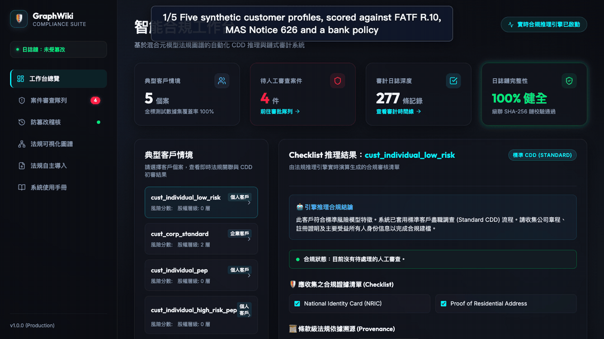
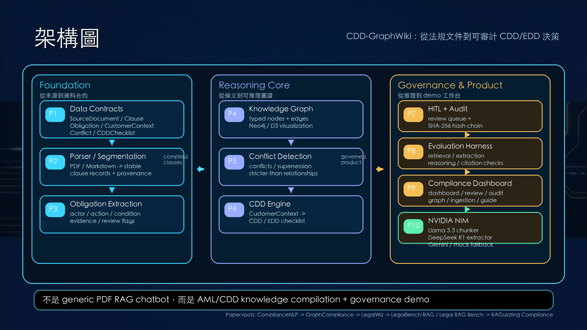
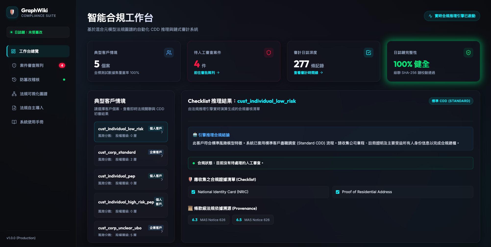
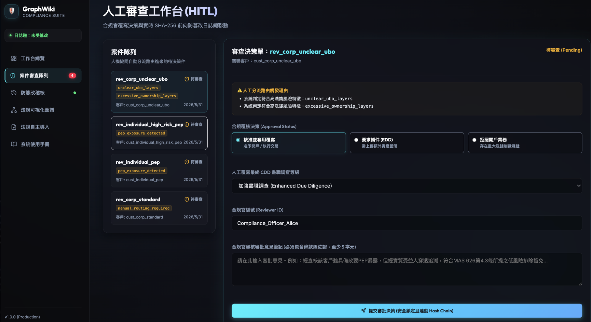
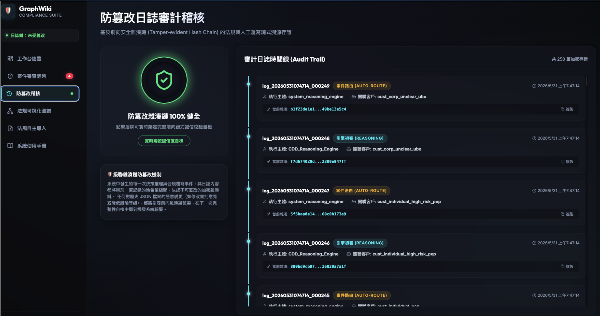
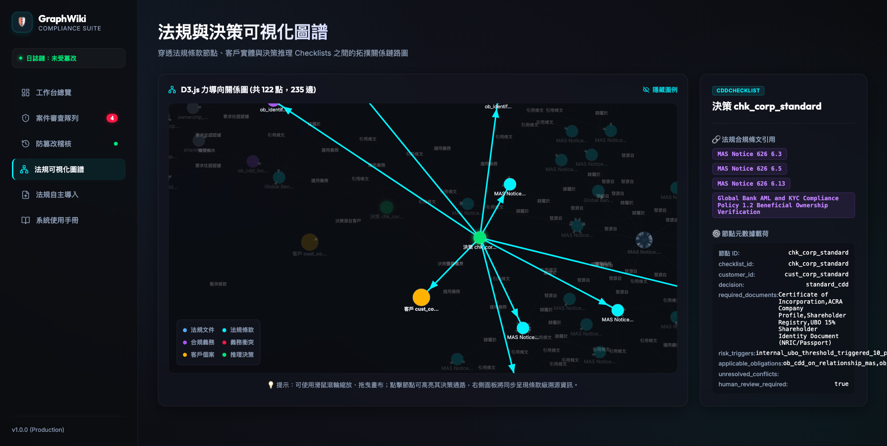
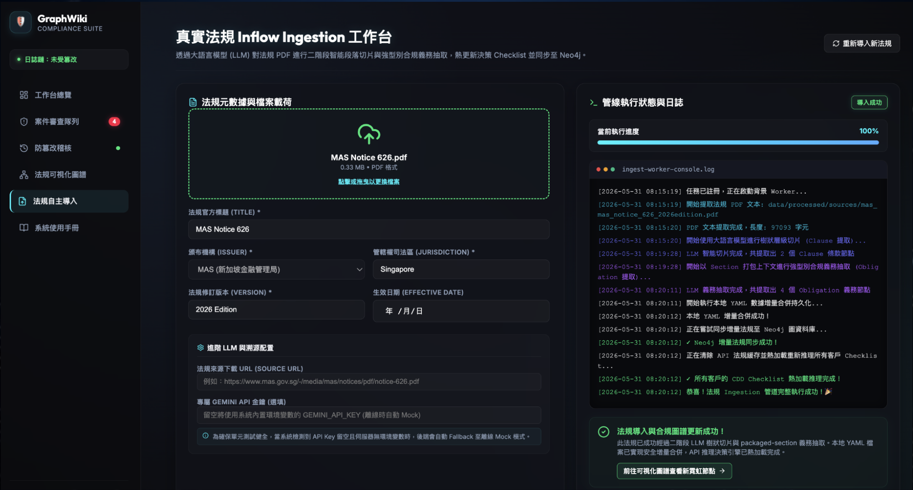

# CDD-GraphWiki

[](https://github.com/DancinAndrew/CDD-GraphWiki/actions/workflows/ci.yml)

**What it is:** a proof-of-concept anti-money laundering (AML) customer due diligence (CDD) workflow. It parses verbatim excerpts of FATF Recommendation 10 and MAS Notice 626, plus a fictional bank policy, into 54 schema-validated clauses and links them in a knowledge graph with obligations, conflicts and customer contexts. A rule-based extractor finds all 13 obligations in the development gold set, with the right source clauses. The system flags 3 conflicts between sources, such as 25% versus 10% beneficial ownership thresholds. It generates CDD/EDD checklists that cite their source clauses for 5 synthetic customer profiles, and routes high-risk cases to human review with a SHA-256 hash chain audit log.

**Held-out tests:** the first rules (v1) matched every development obligation but found only 1 of 18 obligations in the 157 other paragraphs of the official MAS Notice 626, labelled and committed before the rules were run. The rules were rebuilt (v2) around how a requirement is phrased: which verb a modal governs, permissions and exemptions, who must be identified, and how list items relate to their lead-in. v2 was frozen before a second regulation was fetched and labelled: Part 3 of the UK Money Laundering Regulations 2017, which neither version had seen. There v2 found 15 of 32 labelled obligations at precision 0.88; v1 found none, and at most 3 when told to treat the text as FATF or MAS. A local open-weight LLM (qwen3.5:9b) given the same written guideline found 26 of 32, but at precision 0.43. The rules miss half and the LLM over-labels, so neither replaces the human review step. An independent review of the UK labels by Claude sub-agents, under a decision rule fixed before it ran, changed 1 of the 75 labelled clauses and left the paragraph-level scores unchanged; it also found 29 cases the annotation guideline does not decide.

**Explanations:** every rule decision records the words that triggered it (character offsets into the clause) and the rule that fired, and the dashboard highlights them. Deletion tests in the style of ERASER check that these reasons are what the decision used: deleting the cited words removes the label, and keeping only them keeps it, for all 81 held-out labels (51 MAS, 30 UK) and for 42 of 46 development labels (the 4 exceptions come back through a second route in the list structure). The same tests on the LLM's own quoted evidence (a second prompt asks it to quote the words behind each label): deleting its quotes removed the label in 111 of 170 cases, keeping only its quotes kept the label in 88 of 164, and both held for 53 of 161, although its quotes cover about three quarters of the clause text. Confidence scores are no longer hand-set: each rule type carries its measured precision on the unseen UK text (for example 8 of 9, 3 of 4) or says it was not measured. Checklists are explained by the decision tree's actual path and by single-attribute counterfactuals; this exposed four problems in the original decision logic, such as risk flags listed without being checked, which have since been fixed.

**My role:** individual final project for the IT Risk Management course at National Central University (May–June 2026). I designed and built the data contracts, gold dataset, extraction and decision rules, evaluation, API and dashboard. The November 2026 extension (the held-out tests, rules v2, the explanations, the engine fixes and the label review) was built with an AI coding agent (Claude Code) under my direction.

**How to run:** `docker compose -f deployment/docker-compose.yml up --build` starts the dashboard at `http://localhost:3000`. `PYTHONPATH=backend python -m src.pipeline` rebuilds `data/processed` and prints every number below. `PYTHONPATH=backend pytest backend/tests` runs the tests. `PYTHONPATH=backend python -m src.heldout.evaluate`, `PYTHONPATH=backend python -m src.heldout.llm_compare score` and `PYTHONPATH=backend python -m src.heldout.llm_faithfulness score` recompute the held-out scores and deletion tests from cached answers, and `PYTHONPATH=backend python -m src.heldout.label_review` rebuilds the label review.

| Number | Where it comes from |
| --- | --- |
| 54 clauses with text, plus 5 section-heading records (59 records: FATF 17, MAS 28, fictional bank policy 14) | [`data/processed/clauses.yaml`](data/processed/clauses.yaml), parsed from [`data/sources/`](data/sources/) |
| 13/13 gold obligations found, each with the right anchor clause, jurisdiction and full set of source clauses | [`data/processed/evaluation_report.txt`](data/processed/evaluation_report.txt) |
| 3 conflicts: ownership 25% vs 10%, occasional transactions USD/EUR 15,000 vs S$20,000, PEPs allowed vs prohibited | [`data/processed/conflicts.yaml`](data/processed/conflicts.yaml) |
| 5 checklists for 5 synthetic profiles, 4 routed to human review | [`data/processed/checklists.yaml`](data/processed/checklists.yaml) |
| All numbers in one file | [`data/processed/summary.json`](data/processed/summary.json) |
| Held-out MAS Notice 626 (157 paragraphs, labels committed before v1 ran): v1 1/18 (precision 0.14); v2 18/18 (0.95, but v2 was designed after studying these errors); LLM 16/18 (0.40) | [`data/heldout/results/mas_notice_626/`](data/heldout/results/mas_notice_626/) |
| Held-out UK MLR 2017 Part 3 (137 paragraphs, labels committed after v2 was frozen): v1 0/32; v2 15/32 (0.88); LLM 26/32 (0.43), 1 of 173 returned clause IDs invented | [`data/heldout/results/uk_mlr_2017/`](data/heldout/results/uk_mlr_2017/) |
| UK labels reviewed independently (2 blind re-annotations, 1 critic, 3 adjudicators on different models; decision rule fixed in advance): 1 of 42 disputed clauses changed, paragraph scores unchanged, 29 cases the guideline does not decide | [`data/heldout/reviews/uk_mlr_2017/`](data/heldout/reviews/uk_mlr_2017/REPORT.md) |
| Rule explanations pass both deletion tests: 81/81 held-out labels, 42/46 development labels; cited words cover about 20% of the clause text they touch | [`rules_v2_faithfulness.txt`](data/heldout/results/uk_mlr_2017/rules_v2_faithfulness.txt), [`explanation_faithfulness.txt`](data/processed/explanation_faithfulness.txt) |
| The LLM's quoted evidence on the UK text: deletion test 111/170, quotes-only test 88/164, both 53/161; its quotes cover 76% of the clause text (median 93%) | [`llm_qwen3_5_9b_evidence_faithfulness.txt`](data/heldout/results/uk_mlr_2017/llm_qwen3_5_9b_evidence_faithfulness.txt) |
| Confidence = measured precision of the rule type on the unseen UK text (cdd_triggers 8/9, verify_customer 3/3, identify_ubo 3/4, prohibit_anonymous 1/1; PEP EDD and CDD-incomplete found 0 of 4 and 0 of 2, so no precision) | `rule_reliability` in [`summary.json`](data/processed/summary.json) |

The development gold set in [`data/gold/`](data/gold/) was annotated for this project and the rules were written against it, so 13/13 shows that the rules cover the annotated obligations; the held-out rows show how far they generalise. The LLM chose clause IDs from the one paragraph it was sent, so its few invalid citations do not show it would cite correctly without that list. The MAS texts are checked line by line against the official PDF in [`data/sources/official/`](data/sources/official/) by the test suite.



---

CDD-GraphWiki 是一個為「科技風險管理」課程開發的專案，結合了 AI 輔助的風險工作流程，以及以圖（graph）為基礎的知識組織方式。

它探討的是：如何把合規文件、風險義務、客戶／實體資訊、審查決策、稽核證據，組織成一條可追溯的工作流程，而不是做成一個通用的「上傳 PDF 然後聊天」的應用。

## 30 秒摘要

- **這是什麼：** 一個概念驗證（proof-of-concept）的合規工作流程系統，針對 AML／CDD 盡職調查情境。
- **它展示了什麼：** 結構化的合規知識萃取、以圖為基礎的關係對應、CDD／EDD 檢查清單生成、人工審查路由，以及防篡改的稽核日誌。
- **為什麼重要：** 風險與合規工作仰賴大量零散的文件、要求、實體、證據、簽核和歷史決策。這個專案示範了一種做法——讓 AI 與知識圖譜支援這套流程，同時保持「人的判斷」與「來源出處」清楚可見。
- **目前狀態：** 課程期末專案／可運作的原型，不是正式的法律或合規決策系統。

## 問題

風險與合規審查經常需要在零散的文件、政策、實體紀錄、義務和歷史審查決策之間翻找。這帶來幾個實際的問題：

- 資訊散落在不同的文件和系統裡
- 實體、文件、風險、義務和證據之間的關係很難追蹤
- 人工查找拖慢了合規審查與盡職調查的流程
- 團隊需要的是可解釋、可追溯的檢索，而不是模型給出的黑箱答案
- 高風險的決策仍然需要人工審查、上呈與可稽核性

## 解法

CDD-GraphWiki 把合規知識組織成結構化的物件與圖的關係，再用這套結構去支援風險審查流程。

原型的處理流程如下：

1. 匯入法規或政策來源。
2. 把來源切分成穩定的條文（clause）紀錄。
3. 萃取合規義務與證據要求。
4. 建立一張法規知識圖譜，連結文件、條文、義務、客戶、衝突和檢查清單。
5. 從結構化的客戶情境（customer context）生成 CDD／EDD 檢查清單。
6. 把高風險案件路由到人工介入（human-in-the-loop）的審查。
7. 用防篡改的 SHA-256 雜湊鏈，記錄推理過程、案件路由和審查者的決策。

目標不是取代合規判斷，而是讓資訊檢索、關係對應、審查路由和稽核證據更容易被檢視。

## 與合規／風險管理的關聯

示範的領域是 AML／CDD，但這套設計模式同樣適用於更廣的風險與合規工作流程，包含產品合規的情境。

產品合規團隊通常需要管理：

- 法規要求與標準
- 產品需求與測試證據
- 認證或核可紀錄
- 風險發現與緩解決策
- 文件與產品之間的關聯
- 跨部門的審查歷史

CDD-GraphWiki 展示了在這些情境中可以轉移套用的工作流程概念：

- 文件與需求的檢索
- 風險證據的組織
- 實體／文件／義務之間的關係對應
- 可追溯的 AI 輔助審查支援
- 高風險決策的人工簽核邊界
- 供日後查閱的稽核日誌

## 主要功能

- **結構化的合規資料契約：** 以 JSON Schema 和 Pydantic 模型定義來源文件、條文、義務、客戶情境、衝突、檢查清單、圖節點和稽核日誌。
- **規則式義務萃取（第 2 版）：** 規則判斷的是句子的結構，不是特定字串（[`frames.py`](backend/src/extraction/frames.py)）：動作要由 shall／must 這類助動詞要求、或是條列開頭的動詞才算義務；「may」和「shall not be required to」這類放寬句不算；要被識別的是客戶還是實質受益人決定義務類型；條列項目依導言的性質決定要不要承接類型；一條條文可以同時屬於多種義務。持股與金額門檻直接從條文文字解析（例如 `25%`、`USD/EUR 15,000`、`S$20,000`），不依賴特定條文 ID 或管轄區。評估同時檢查義務是否對應到正確的條文與管轄區。
- **衝突偵測：** 比較不同來源對同一類義務的門檻或立場，目前涵蓋三類（持股門檻、偶發交易門檻、PEP 允許與禁止）。衝突會引用實際寫出數字或禁止字樣的條文。如何調和衝突是人的決定，記錄在 [`data/reviews/conflict_adjudications.yaml`](data/reviews/conflict_adjudications.yaml)；沒有裁決紀錄的衝突會讓相關檢查清單送人工審查。
- **CDD／EDD 決策：** 以規則為基礎，從結構化的客戶情境生成檢查清單，包含所需文件、風險觸發條件、引用出處、衝突，以及人工審查標記。引用一律是適用義務的錨點條文 ID，可以在圖譜上一路追回原文。
- **人工介入審查：** 針對高風險或不明確的案件提供審查佇列，審查者的決策與註記都透過 FastAPI 驗證後記錄下來。
- **防篡改稽核軌跡：** 用 SHA-256 雜湊鏈記錄推理過程、案件路由和審查者的覆寫。
- **法規圖譜視覺化：** 以 D3 製作的互動式圖，連結來源文件、條文、義務、衝突、客戶和生成的檢查清單。
- **Neo4j 圖資料庫支援：** 可選的圖資料庫同步，以及用 Cypher 進行 UBO 股權穿透追蹤／循環偵測。
- **PDF 匯入工作流程：** PDF 上傳、文字萃取、LLM 輔助的條文切塊、結構化義務萃取、YAML 合併、快取刷新，以及圖譜／檢查清單更新。若沒有接上真實 LLM（或呼叫失敗退回 mock 模式），匯入會失敗，不會把合成資料寫進知識庫。
- **評估與治理產出物：** 黃金資料集（gold dataset）、評估工具（evaluation harness）、未用於開發的 held-out 測試與 LLM 對照、OpenSpec 需求、ADR，以及系統路線圖文件。評估工具內的 `ScriptedRAGBaseline` 是刻意寫入錯誤的測試 fixture，用來確認評估工具抓得到錯判與幻覺引用，不是真實系統的分數。

## Demo 與視覺素材

在本機跑起應用後，即可使用線上 demo：

- 前端儀表板：`http://localhost:3000`
- 後端 API 文件：`http://localhost:8000/docs`
- Neo4j Browser：`http://localhost:7474`

既有的視覺素材：



- 架構圖：[`docs/assets/phase_1_10_architecture.png`](docs/assets/phase_1_10_architecture.png)
- 未來發展方向預覽：[`docs/assets/future_development_direction_preview.png`](docs/assets/future_development_direction_preview.png)
- 投影片／第 15-21 頁的 demo 解說：[`docs/presentation_script_pages_15_21.md`](docs/presentation_script_pages_15_21.md)

專案投影片包含更完整的儀表板導覽，涵蓋儀表板、審查佇列、稽核時間軸、圖譜檢視、匯入主控台和使用者指南。

## 畫面截圖

以下是實際運作 demo 的截圖。每個頁面負責合規審查流程中的一個步驟。

### 1. 合規儀表板（Compliance Dashboard）



首頁。最上方顯示一個快速摘要（有多少客戶、有多少案件需要人來看、有多少已經處理完）。你從左邊的清單挑一個客戶，系統就會自動產生一份檢查清單——列出這個客戶需要哪些文件和檢查，並列出這份清單依據的條文（官方法規或銀行內部政策）。

### 2. 人工審查佇列（Human Review Queue）



當案件有風險或不明確時，系統不會自己下決定，而是把案件送到這裡讓真人來審查。審查者讀完案件後，挑一個決定（核准、要求更深入的查核，或駁回），寫下說明理由的註記，然後送出。這讓重要的決定始終由人來掌控。

### 3. 稽核軌跡（Audit Trail）



一份完整的歷史紀錄——所有發生過的事、每一個決定、每一次審查，按順序排列。每一筆紀錄都用數位「指紋」（雜湊）鏈鎖在一起，所以如果有人想偷偷竄改舊紀錄，馬上就會被發現。這就是你日後可以拿出來證明「流程確實有照規矩走」的依據。

### 4. 知識圖譜檢視（Knowledge Graph View）



一張互動式的地圖，呈現所有東西怎麼連在一起——法規、文件、客戶、要求和生成的檢查清單都畫成圓點，再用線標出彼此的關係。你不必在一堆分散的檔案裡翻找，就能看到全貌，並追溯任何一項要求是從哪裡來的。

### 5. 法規匯入主控台（Regulation Ingestion Console）



把新法規加進系統的地方。你上傳一份官方法規文件（PDF），系統會讀取它、把它切成一條條條文，並自動抽出其中的義務。右邊的面板會即時顯示處理檔案的進度。

## 系統架構

```text
Source PDFs / Markdown / Policies
        |
        v
PDF parser and source document records
        |
        v
Clause segmentation and structured obligation extraction
        |
        v
YAML gold / processed datasets + JSON Schema / Pydantic contracts
        |
        v
Regulatory graph: documents, clauses, obligations, conflicts, customers, checklists
        |
        v
CDD / EDD checklist generation
        |
        v
Human review queue + tamper-evident audit log
        |
        v
React dashboard, D3 graph view, FastAPI endpoints, optional Neo4j queries
```

重要的設計邊界：系統把客戶輸入當成結構化的 `CustomerContext` 來處理，而不是當成不受限制的 prompt。高風險的決策一律路由到人工審查。

## 技術堆疊

- **前端：** React 18、TypeScript、Vite、D3、lucide-react
- **後端：** Python、FastAPI、Pydantic、PyYAML、jsonschema
- **匯入：** pypdf、PDF 文字萃取、結構化的條文與義務萃取
- **圖：** 記憶體內的法規圖建構器、D3 視覺化、可選的 Neo4j Community Edition
- **AI／LLM：** 支援 NVIDIA NIM、Gemini 後備方案；mock 模式只供測試，產出不會寫入知識庫
- **資料：** YAML 黃金資料集、處理後資料集、JSON Schema 契約
- **測試：** pytest 後端測試、評估工具、範例 schema
- **部署：** Docker、Docker Compose
- **治理：** OpenSpec 規格／變更，以及 ADR 決策紀錄

## 專案資料

- 論文／書面報告：[Google Docs](https://docs.google.com/document/d/18sSEPHwYYoJUjvCJkYucqSJ-gF9ndiVysm-VFIubL8g/edit?tab=t.0)
- 簡報投影片：[Google Slides](https://docs.google.com/presentation/d/1fYlCTjPTBb8Kf8QJfHVWZ1CbFYJCz8LnEv-pMoTzKeQ/edit?slide=id.g3ec91351360_1_53#slide=id.g3ec91351360_1_53)
- 產品／規格論述：[`docs/SPEC.md`](docs/SPEC.md)
- 系統路線圖：[`docs/system-build-roadmap.md`](docs/system-build-roadmap.md)
- 架構決策：[`docs/adr/`](docs/adr/)
- OpenSpec 契約：[`openspec/`](openspec/)

## 如何執行

### 方式 A：用 Docker Compose 執行

```bash
git clone https://github.com/DancinAndrew/CDD-GraphWiki.git
cd CDD-GraphWiki
cp .env.example .env
docker compose -f deployment/docker-compose.yml up --build
```

接著打開：

- 前端：`http://localhost:3000`
- 後端 API 文件：`http://localhost:8000/docs`
- Neo4j Browser：`http://localhost:7474`
  - 帳號：`neo4j`
  - 密碼：`testpassword123`

預設的 `.env.example` 裡放的是佔位用的 AI 金鑰。即使沒有真正的模型金鑰，核心 demo 資料和所有規則式流程都能執行；只有 PDF 匯入（含 LLM 萃取）需要設定好的供應商金鑰。

### 方式 B：後端與前端分開執行

後端：

```bash
python3 -m venv .venv
source .venv/bin/activate
pip install -r backend/requirements.txt
PYTHONPATH=backend uvicorn src.api.main:app --reload --port 8000
```

前端：

```bash
cd frontend
npm install
npm run dev -- --host 0.0.0.0 --port 3000
```

基本 demo 不一定要 Neo4j。如果 Neo4j 不可用，API 會在數個圖工作流程上退回（fallback）到記憶體內的行為。

### 重現所有數字與測試

```bash
PYTHONPATH=backend python -m src.pipeline
PYTHONPATH=backend pytest backend/tests

# 未用於開發的測試（held-out）：規則與 LLM 在 MAS Notice 626 全文上的表現
PYTHONPATH=backend python -m src.heldout.evaluate          # 規則式萃取器
PYTHONPATH=backend python -m src.heldout.llm_compare score      # 用快取的 LLM 回答重新計分，不需要模型
PYTHONPATH=backend python -m src.heldout.llm_faithfulness score  # LLM 引用依據的刪字測試，也用快取計分

# 重新呼叫本機模型（選用，需要 ollama pull qwen3.5:9b）
PYTHONPATH=backend python -m src.heldout.llm_compare run --set uk_mlr_2017              # 標準提示詞
PYTHONPATH=backend python -m src.heldout.llm_compare run --set uk_mlr_2017 --evidence   # 要求附上依據
PYTHONPATH=backend python -m src.heldout.llm_faithfulness run --set uk_mlr_2017         # 對依據做刪字測試
```

GitHub Actions 每次 push 都會跑全部測試、重跑管線與 held-out 評估，並確認輸出和 commit 的檔案完全相同。

管線會依序執行：解析來源 → 萃取義務並與金標比對 → 偵測衝突並套用人工裁決 → 為 5 個合成客戶產生檢查清單，把結果寫進 `data/processed/` 並印出摘要。輸出是確定性的，重跑兩次檔案內容完全相同。測試會先把管線跑到暫存目錄，稽核日誌也寫到暫存檔，不會改動 repo 裡的資料。

## 未用於開發的測試（held-out）

開發資料上的滿分是在寫規則時看過的資料上得到的，不能說明規則能不能用在新的條文上。所以這裡做了兩輪測試，每一輪都是「先把答案標好並 commit，之後才讓規則作答」，git 歷史可以看到順序。標註依同一份 [`標註準則`](data/heldout/ANNOTATION_GUIDELINE.md)，只標系統建模的 8 種義務類型。

**第一輪：MAS Notice 626 其餘 157 段**
1. 用 [`convert.py`](backend/src/heldout/convert.py) 把官方 PDF 轉成 167 段、419 筆條文；測試逐行比對 PDF 原文，跨頁的段落也一樣。
2. 寫規則時用過的 10 段（6.3、6.5、6.6、6.9、6.13、6.14、6.14B、6.35、8.2、8.3）整段排除，剩下 157 段；標註（[`gold_labels.yaml`](data/heldout/gold_labels.yaml)）先 commit，共 16 段、18 項義務。
3. 第 1 版規則只找到 1 項。原因：規則綁定開發段落的句型（6.31 換個寫法就漏掉，10.3 剛好含有相同句型反而誤判）、只認得特定管轄區（MAS 6.1 明寫禁止匿名帳戶也抓不到）、不懂否定與放寬（6.16「shall not be required to inquire」一段就多出 10 筆誤判）、每條條文只給一種類型。

**改寫規則（第 2 版，[`frames.py`](backend/src/extraction/frames.py)）**：針對上面的錯誤類型，而不是個別段落。
- 要求要有句法依據：助動詞（shall、must、should、is required to）真的管到這個動作，或條列開頭就是動詞。「failure to verify a UBO」不算要求驗證。
- 「may obtain」「shall not be required to」「in lieu of」這類放寬或豁免的句子不算義務。
- 看要被識別的是誰：客戶（含匯款的匯款人、收款人）→ 客戶身分驗證；實質受益人 → 受益人識別；代表客戶行事的人、關聯方 → 都不算。「person identified under paragraph 6.14」這類交叉引用會回頭查 6.14 在講誰。
- 條列看導言的性質：條件清單、「the following measures／information」的項目承接導言的類型；「the bank shall –」底下以動詞開頭的項目是各自獨立的責任；「except where」之後的是例外。
- 一條條文可以同時屬於多種義務；沒有專屬設定的管轄區也照樣判斷。

第 2 版在開發資料上維持滿分，還找到一條原本漏標的義務（銀行政策 1.1），衝突與檢查清單完全不變。它在 MAS 157 段上找到 18／18，但這是看過錯誤之後改出來的，**不算未看過資料的成績**。

**第二輪：英國《Money Laundering Regulations 2017》第 3 部（兩版規則都沒看過）**
1. 第 2 版規則先 commit 凍結（`98332e9`），之後才從 legislation.gov.uk 下載官方 XML（2026-06-30 起生效的修訂版），用 [`convert_uk.py`](backend/src/heldout/convert_uk.py) 轉成 137 款、443 筆條文；測試逐行比對 XML 原文。
2. 標註（[`gold_labels_uk_mlr_2017.yaml`](data/heldout/gold_labels_uk_mlr_2017.yaml)）先 commit（`5a89252`），共 30 款、32 項義務，才第一次讓規則和 LLM 作答。
3. 之後用 Claude sub-agent 獨立審核這份標註，改不改的規則在審核前就寫定。結果只改了一處，段落層級的分數不變（見下方「標註審核」）。

| 段落層級：找到幾項（精確率） | MAS 157 段 | 英國第 3 部（未看過） |
| --- | --- | --- |
| 第 1 版規則 | 1／18（0.14） | 0／32；當成 FATF 或 MAS 處理最多 3／32 |
| 第 2 版規則 | 18／18（0.95，已看過錯誤） | **15／32（0.88）** |
| 本機 LLM qwen3.5:9b | 16／18（0.40） | 26／32（0.43） |

完整報告：[`MAS`](data/heldout/results/mas_notice_626/)、[`英國`](data/heldout/results/uk_mlr_2017/)。模型的原始回答存在 [`data/heldout/llm_runs/`](data/heldout/llm_runs/)，沒有模型也能重新計分。

**第 2 版在英國法規上漏掉什麼**（[`rules_v2_report.txt`](data/heldout/results/uk_mlr_2017/rules_v2_report.txt)）：禁止匿名帳戶 1／1、CDD 觸發 8／13、客戶身分驗證 3／4、受益人識別 3／8、PEP 加強審查 0／4、無法完成 CDD 須停止 0／2。漏掉的主要是四種寫法：
- 要求被拆在導言與條列兩層：31(1) 的「unable to apply CDD」在導言，「must not carry out any transaction」在 (a)；規則只在同一條條文內判斷。
- 字面仍太窄：PEP 規則要求出現「enhanced」，英國 35(5) 寫的是「in addition to the measures required by regulation 33」；金額門檻要求句中有「transaction」，27(7E) 寫的是「transfer」。
- 主詞藏在條件裡：「Where the customer is a body corporate — (a) obtain and verify the name of the body corporate」。
- 需要領域知識：信託受益人就是實質受益人、找不到受益人時視為受益人的高階主管。

**LLM 的問題在另一邊**（[`llm_qwen3_5_9b_report.txt`](data/heldout/results/uk_mlr_2017/llm_qwen3_5_9b_report.txt)）：它在英國法規上找到 26／32，比規則多，但精確率只有 0.43。只要是加強審查都標成 PEP 義務（33(3A) 高風險國家、34(1) 代理銀行）；保單受益人（29(3)–(5)）、代表客戶行事的人（28(10)）和「may」放寬條款（30(3)、30(4)）都標成客戶身分驗證，雖然準則明寫不算；空殼銀行（34(2)）和匿名預付卡（38(4A)）被當成匿名帳戶。它也第一次捏造了一個不存在的條文 ID（`27_8_zb`，照命名規則自己拼出來的）。規則和 LLM 都漏掉的，集中在需要判斷的標註（30A 公司登記資料、30(7) 信託受益人、28(9)），這幾項換一位標註者也可能不同。

**結論**：改寫後的規則在沒看過的法規上，精確率維持在 0.88，找到的義務從最多 3／32 提高到 15／32，而且每一個判斷都能指出是哪條句型規則。規則精確但漏掉一半，LLM 找得多但一半以上是錯的，兩者錯在不同地方；所以系統保留人工審查。把兩者串起來（例如規則先判、LLM 補漏、再交人工）是可以研究的下一步，目前沒有做。

**這個測試的限制**：兩份標註都只依書面準則標了一次，沒有第二位獨立標註者；英國那份另外由模型重標與審核（見下），但沒有具法律背景的人複核，MAS 那份沒有審核；項目數不多（18 項、32 項），數字的波動會很大；英國第 3 部有幾項標註需要判斷（例如 30A 的公司登記資料、30(7) 的信託受益人），換一位標註者可能不同；LLM 只測了一個 9B 的本機模型；LLM 回傳的條文 ID 只能從送給它的那一段裡選，所以無效 ID 很少不代表它在開放情境下不會捏造引用。

**標註審核**（[`REPORT.md`](data/heldout/reviews/uk_mlr_2017/REPORT.md)）：英國標註只有作者一人標，作者也讀不太懂法條，所以另外請 Claude sub-agent 審核。改標註的規則在任何審核者開跑前就寫進 [`PROTOCOL.md`](data/heldout/reviews/uk_mlr_2017/PROTOCOL.md)：三位裁決者中至少兩位選出同一組類型，而且都指出原標註違反準則的哪一句，才改。審核者看不到規則和 LLM 的答案；修訂版標註由 [`label_review.py`](backend/src/heldout/label_review.py) 從投票結果產生，CI 每次重建比對。
- 兩位盲標者（不看原標註，從頭標）與原標註的一致度：段落層級 F1 0.89、條文層級 0.88。兩位盲標者的答案完全相同，因為用的是同一個模型，只能算一種讀法。
- 42 處不一致交給三位分別使用不同模型的裁決者：改 1 處、維持 12 處，另外 29 處裁決者認為準則的文字不足以判斷，依規則維持原標註。
- 唯一的修改：28(3)(b)(ii) 法人客戶的董事與高階人員姓名屬於「關聯方」，準則明寫不算客戶身分驗證。28(3) 這一款仍因其他項目屬於客戶身分驗證，所以段落層級的分數完全不變；條文層級各系統的召回率約高 0.01。
- 如果連多數裁決者偏好、但不認為原標註有錯的 7 處也一起改，規則 v2 的段落 F1 會從 0.61 降到 0.57（多出來的都是規則漏掉的），LLM 從 0.57 到 0.56。審核沒有把標註推向對規則有利的方向。
- 限制：審核者全是 Claude 模型，不是法律專家，同一家族的模型可能有相同的誤讀，也沒有具法律背景的人複核。所以結論是「審核找到 1 個問題」，不是「標註已驗證正確」。準則沒講清楚的 7 類情況列在報告裡，現在改準則等於看過分數再重標，所以沒有改。

## 可解釋性：每個判斷都說得出依據，而且依據是真的

這一節回答三個問題：每個判斷能不能指出依據？那個依據是不是系統真正用的？它對自己有幾分把握，這個數字從哪裡來？

**1. 規則的判斷理由，用刪字測試檢查**

第 2 版規則判斷時，會把觸發的字詞（含在原文中的位置）和規則名稱一起記下來，存在每個義務的 `explanations`，儀表板會把這些字標亮。例如 MAS 6.35 被判為「無法完成 CDD 須停止」，依據是「unable to complete」與「shall not commence」出現在同一句；條列項目則記錄它從哪一條導言繼承、靠的是導言裡哪幾個字。

理由是不是真的，用 ERASER（DeYoung et al., ACL 2020，評估「模型給的理由是否可信」的公開基準）的兩個指標檢查，兩者都重新判斷整份文件：
- **刪掉理由字詞**，判斷應該消失（comprehensiveness）；
- **只留理由字詞**，判斷應該還在（sufficiency）。

| 標記（條文, 類型） | 數量 | 刪掉理由後消失 | 只留理由仍成立 | 理由約佔相關條文文字 |
| --- | --- | --- | --- | --- |
| 開發資料 | 46 | 42 | 46 | 31%（中位數 22%） |
| MAS Notice 626 其餘 157 段 | 51 | 51 | 51 | 20%（17%） |
| 英國 MLR 2017 第 3 部（沒看過） | 30 | 30 | 30 | 22%（18%） |

怎麼讀這個結果：
- 規則的理由是從做判斷的同一段程式記下來的，所以這個測試驗證的是「理由記錄完整、判斷沒有用到理由以外的字」，不是證明判斷正確：判斷錯的標記，理由一樣會通過。
- 開發資料上有 4 項刪掉理由後類型又回來了，都在實質受益人識別。原因是規則有第二條路：例如 MAS 6.14 的導言自己要求識別受益人，它的項目 (a)(i) 也這樣要求，刪掉導言的字，類型又從項目上推回來。這是規則本身的性質，不是漏記，測試保留這 4 個失敗。
- MAS 的 51 項中有 32 項、英國的 30 項中有 12 項來自條列繼承或上推，它們的結果跟著導言的測試走，不是獨立的證據。報告依「本條文自己的字詞」與「條列結構」分開列出（[`rules_v2_faithfulness.txt`](data/heldout/results/uk_mlr_2017/rules_v2_faithfulness.txt)）。

**2. LLM 的理由：同樣的測試**

LLM 另外跑了一版提示詞（`heldout-v2-evidence`）：任務定義完全相同，只多要求每個判斷附上「從原文逐字複製、最短的依據」。在英國法規上，這一版找到 26／32、精確率 0.37。對它的每個判斷做同樣兩個測試（刪掉它引用的字、只留它引用的字，再問一次同一個模型）：

| 英國 MLR 2017 第 3 部 | 判斷數 | 刪掉依據後消失 | 只留依據仍成立 | 兩者都通過 | 依據約佔相關條文文字 |
| --- | --- | --- | --- | --- | --- |
| 第 2 版規則 | 30 | 30／30 | 30／30 | 30／30 | 22%（中位數 18%） |
| 本機 LLM（附依據的那一輪） | 173 | 111／170 | 88／164 | 53／161 | 76%（中位數 93%） |

- LLM 寫出的依據常常不是它真正的依據：刪掉它引用的字，三分之一的判斷照樣成立；只留它引用的字，將近一半的判斷消失。兩個測試都通過的只有三分之一。
- 它的依據平均佔相關條文的四分之三，多半是整條照抄，沒有指出是哪幾個字。
- 只留依據時，LLM 看到的是被挖空的段落，這不是它平常的輸入；但這正是測試要問的：如果它說的依據是完整的，挖掉其他字就不該改變判斷。
- 這裡測的是理由忠不忠實，不是判斷對不對；這一輪的判斷本身在段落層級的精確率是 0.37。格式不符的答案（兩個測試各 3 個、9 個）另外計算，不算通過也不算失敗。
- 規則的理由是由做判斷的程式記下來的，本來就應該通過；LLM 的理由是另外生成的一段文字。這個對照說明的是：要讓人審查得快又放心，理由必須來自判斷本身，不能只是模型事後的說法。
- 執行細節：Ollama 的 JSON 模式偶爾在 JSON 結束後停不下來，所以後來加了 2,048 token 的輸出上限。137 段中前 103 段在加上限前跑完（最長的回答 2,476 字元，遠低於上限）；有一段（34(3)）重複輸出到上限，答案無效，計為格式不符。

**3. 信心分數改成實測值**

以前每個義務附的 confidence（0.8–0.99）是寫在程式裡的常數，0.75 的門檻也從來沒有擋掉任何東西。現在 `confidence` 是這類規則在沒看過的英國法規上的段落精確率，`confidence_basis` 寫明樣本：

| 義務類型 | 英國法規上被規則標出 | 其中正確 | confidence |
| --- | --- | --- | --- |
| 禁止匿名帳戶 | 1 | 1 | 1.0 |
| CDD 觸發 | 9 | 8 | 0.89 |
| 客戶身分驗證 | 3 | 3 | 1.0 |
| 受益人識別 | 4 | 3 | 0.75 |
| PEP 加強審查 | 0（標註有 4 段，全漏） | – | 無 |
| 無法完成 CDD 須停止 | 0（標註有 2 段，全漏） | – | 無 |
| PEP 禁止、PEP 核准 | 0（英國法規沒有這類條文） | – | 無 |

樣本很小（1 到 9 段），所以這些數字只能當「量過一次」的紀錄，不是可靠的機率。英國標註經獨立審核後，信心值改用審核後的標註計算（審核前就決定）；唯一的修改不影響段落層級的計數，所以數值沒變。PDF 匯入時 LLM 自己報的分數另外標成「模型自評、未校準」（`confidence_kind`）。

同一段文字上規則和 LLM 都有答案時，報告也依「誰提出」分三級（英國法規，段落層級，標準提示詞那一輪）：兩者都提出 14 項，14 項正確；只有規則 3 項，1 項正確；只有 LLM 46 項，12 項正確。MAS 上對應的是 16／17、2／2、0／23，但 MAS 是改規則時看過的。

**4. 檢查清單：真正的決策路徑與「如果…會怎樣」**

以前儀表板的「推理結論」是依決策等級寫死的固定文字，不管客戶實際情況；產生審計報告用的解釋路徑（`ProvenanceEngine`）則是從文件名稱用關鍵字猜義務（例如看到「senior management」就對到 PEP 加強審查），客戶事實也是依義務寫死的。現在：
- 決策引擎改寫成明確的決策樹。重構時對 4,608 種客戶組合的輸出與舊版完全相同；之後修正了下面四個問題，測試在 18,432 種組合上確認：新版和另一份獨立寫成的參考實作完全相同，和舊版的差異只出現在受影響的四類客戶。
- 每份清單附上決策路徑：每個判斷讀了哪些客戶資料、結果是什麼；「或」條件會列出哪幾個子條件成立。
- 每份要收的文件依據哪個義務、哪幾條原文，原文中的依據字詞標亮；條列項目另外列出導言或被引用條文中的依據字詞。
- 風險標記只列出對這位客戶成立的，並說明由什麼保證成立：決策路徑已經檢查過，或標記自己的條件（例如受益人不明的企業，路徑不看持股層數，多層持股標記另外檢查層數）。檢查過但不成立的標記另外列出。
- 「如果…會怎樣」：只改一個客戶屬性、重跑引擎後輸出確實改變的情況，以及「讀了但單獨改變也不影響結果」的屬性（例如緬甸籍、國家風險又是高的政要，兩個條件只改一個，結果不變）。
- 列出決策樹從不讀取的客戶資料。

這個改寫讓原有設計的問題浮上來，下面四個已經修正：
- **風險標記和客戶資料對不上。** 「受益人不明」分支不管客戶資料，一律列出 `excessive_layering_5` 與 `missing_source_of_funds_evidence`；只有 1 層持股、資金來源齊全的企業也會被標上。現在標記只在條件成立時列出。
- **多層持股的門檻錯了，而且不影響決策。** 標記在 5 層以上才成立，但它依據的銀行政策 1.2(b) 寫的是 3 層以上；受益人已識別的多層持股企業被當成一般企業。現在改成 3 層（`complex_ownership_3_layers`），而且這類企業成為決策樹裡的一個分支：依 1.2(b)(i) 列為高風險、走加強盡職調查，並依 1.2(b)(ii) 要求合規主管簽核的完整持股架構圖。
- **資金來源標記沒有法源。** 知識庫只對政要要求資金來源（MAS 8.3(b)、銀行政策 1.4(a)），FATF 10(d) 講的是持續監控、沒有抽出義務。現在只在政要分支檢查資金與財富來源，缺少時各自標記；非政要客戶不再有這個標記。
- **註冊在開曼群島就拒絕開戶。** 決策樹把「註冊地是開曼群島」當成 CDD 無法完成，直接拒絕開戶並評估申報可疑交易，但知識庫沒有任何條文這樣要求。現在只有受益人不明才會拒絕。

金標只改一筆：受益人不明企業的風險標記，從上面三個改成 `unclear_ubo_status` 與 `complex_ownership_3_layers`。

完整結果：[`data/processed/explanation_faithfulness.txt`](data/processed/explanation_faithfulness.txt)、[`rules_v2_faithfulness.txt`](data/heldout/results/uk_mlr_2017/rules_v2_faithfulness.txt)、[`llm_qwen3_5_9b_evidence_faithfulness.txt`](data/heldout/results/uk_mlr_2017/llm_qwen3_5_9b_evidence_faithfulness.txt)；API：`GET /api/v1/customers/{id}/explanation`。

## 專案目錄導覽

- [`backend/`](backend/) - FastAPI 服務、資料契約、決策引擎、稽核管理器、圖建構器、匯入、評估和測試
- [`frontend/`](frontend/) - React 儀表板，包含合規總覽、審查佇列、稽核時間軸、法規圖譜、匯入主控台和使用者指南
- [`data/sources/`](data/sources/) - 管線讀取的三份來源：FATF R.10 與 MAS Notice 626 的官方原文逐字摘錄，以及虛構的銀行內部政策；[`official/`](data/sources/official/) 放 MAS Notice 626 官方 PDF
- [`data/gold/`](data/gold/) - 人工標註的黃金資料集：條文（parser 輸出經人工檢查後凍結）、義務、衝突、客戶情境與預期檢查清單
- [`data/reviews/`](data/reviews/) - 衝突的人工裁決紀錄
- [`data/heldout/`](data/heldout/) - 未用於開發的測試：MAS Notice 626 全文（由官方 PDF 轉出）與英國《Money Laundering Regulations 2017》第 3 部（由 legislation.gov.uk 的 XML 轉出）、標註準則、先於規則執行 commit 的兩份金標、新舊規則與 LLM 的評估結果、LLM 的原始回答，以及英國標註的獨立審核（`reviews/`）
- [`data/processed/`](data/processed/) - `python -m src.pipeline` 產生的結果與 `summary.json`，以及只能追加的稽核日誌 `audit_log.json`
- [`schemas/`](schemas/) - JSON Schema 契約與範例
- [`docs/`](docs/) - 產品規格、路線圖、ADR、論文筆記、簡報支援素材和視覺素材
- [`openspec/`](openspec/) - 需求規格與封存的實作變更
- [`deployment/`](deployment/) - Docker 與 Docker Compose 設定

## 範例工作流程

1. 打開儀表板，檢視可用的客戶情境。
2. 選一個客戶，查看生成的 CDD／EDD 檢查清單。
3. 檢視所需文件、風險觸發條件、適用義務和引用出處。
4. 打開審查佇列，查看需要人工簽核的案件。
5. 送出審查者的決策與註記。
6. 確認稽核時間軸有記錄下推理過程與審查事件。
7. 打開圖譜檢視，檢視文件、條文、義務、客戶、衝突和檢查清單之間的關係。
8. （選用）透過匯入主控台上傳一份法規 PDF，並監看萃取進度。

## 目前的限制

- 這是課程專案的原型，不是正式的法律意見，也不是已部署的合規平台。
- 主要的 demo 語料偏向 AML／CDD，不是產品合規的語料。
- 決策用的語料只是 FATF R.10 與 MAS Notice 626 的部分段落摘錄，加上一份虛構的銀行政策。規則式萃取在沒看過的英國法規上只找到約一半的義務（32 項中 15 項，見上方 held-out 測試），漏掉的多半是要求被拆在導言與條列兩層、字面不同或需要領域知識的寫法。
- 衝突偵測目前只涵蓋三類衝突（持股門檻、偶發交易門檻、PEP 允許與禁止）。
- CDD 決策層刻意設計得受限且以規則驅動，以換取可解釋性：決策分支是寫好的規則，引用則由義務的出處推導。
- 規則的判斷理由通過刪字測試，只代表理由記錄完整、判斷沒有用到理由以外的字，不代表判斷正確；信心分數只在一份沒看過的法規上量過，每類 1 到 9 段，PEP 相關類型沒有可用的精確率。
- 多層持股企業依銀行政策列為高風險，但知識庫裡寫出高風險客戶具體加強措施的條文只有政要用的 MAS 8.3，所以這個分支只多要求持股架構圖。MAS Notice 626 第 8.7 段其實要求：銀行判定為高風險的客戶一律採取 8.3 的加強措施，包括資金與財富來源。這段在 held-out 語料、不在知識庫，搬進來會汙染 held-out 測試，所以沒有納入。`ownership_layers` 視為中間控股公司的層數；緬甸被視為高風險管轄區是寫在決策樹裡的判斷，不是知識庫的條文。
- PDF 匯入用 LLM 切條文，條文 ID 格式和 parser 不同；重跑管線會以 `data/sources/` 重建知識庫，透過匯入主控台加入的文件不會保留。
- 真正的 PDF 匯入時，LLM 萃取仰賴設定好的供應商金鑰。
- 在真正用於合規之前，還需要更嚴謹的檢索評估、人工標註、存取控制和正式的治理機制。

## 未來改進

- 把語料從 AML／CDD 範例擴展到產品合規標準、產品需求文件、認證證據和測試報告。
- 加入證據等級的檢索，結合 BM25、密集檢索（dense retrieval）、GraphRAG，以及字元級（character-span）的引用支援。
- 擴展圖推理，支援產品對需求、需求對測試、風險對證據的可追溯性。
- 強化衝突與落差的裁決，導入 NLI、LLM 輔助的矛盾偵測，以及明確的人工解決流程。
- 加入角色式存取控制（RBAC）、審查者權限，以及正式部署的強化。
- 建立更豐富的截圖／demo 素材資料夾，方便招募者與用人主管快速檢視。

## 修訂紀錄

- **2026-11（課程結束後的修補）：** 移除兩條 PDF 匯入時 LLM 退回 mock 模式產生的合成條文；把 MAS 與 FATF 來源改成官方原文的逐字摘錄（修正 SGD 5,000 應為 S$20,000，以及 25% 門檻出自 FATF 而非 MAS Notice 626）；補上 MAS 第 6.14B 段（驗證受益人）與第 6.35 段（無法完成 CDD 時不得建立業務關係），銀行政策的 PEP 禁令與核准要求拆成兩條義務；萃取規則改成依文字判斷、不再指定條文 ID；衝突與檢查清單的引用改由解析出的條文推導，人工裁決只套用在當時裁決的條文上；評估加入出處檢查；PDF 匯入先驗證再寫檔；新增一鍵重建管線，測試不再改寫 repo 資料。課程繳交版本見 git 歷史中 2026-06 的 commit。
- **2026-11（held-out 測試）：** 把官方 MAS Notice 626 全文轉成可解析的 Markdown；在規則沒看過的 157 段上先標註、先 commit，再跑規則，並用本機開源 LLM 做對照；新增 GitHub Actions，每次 push 都重跑測試、管線與評估並比對輸出；README 加上示範動畫；評估工具裡手寫的對照組改名為 `ScriptedRAGBaseline`，避免被誤認為真實系統。
- **2026-11（規則第 2 版與第二份 held-out 測試）：** 依第一輪的錯誤類型重寫規則（句子結構、放寬句、主詞、條列關係、多重類型），舊版凍結在 [`extractor_v1.py`](backend/src/extraction/extractor_v1.py) 供對照；新規則先 commit 凍結，之後才下載英國《Money Laundering Regulations 2017》第 3 部、先標註再測試。新規則在開發資料上找到一條原本漏標的義務（銀行政策 1.1 客戶身分驗證），金標因此從 12 條變成 13 條。
- **2026-11（可解釋性）：** 規則判斷記錄觸發字詞與規則，並用刪字測試檢查；LLM 另跑一輪要求逐字引用依據，對它的依據做同樣測試；拿掉寫死的信心分數，改成在沒看過的英國法規上實測的精確率；檢查清單引擎改寫成明確的決策樹（輸出與舊版相同），附上決策路徑、每份文件的依據條文與「如果…會怎樣」，取代原本的固定說明文字與關鍵字對應；儀表板顯示這些解釋。
- **2026-11（決策引擎修正）：** 修正決策樹浮現的四個問題：風險標記只在條件成立時列出；多層持股門檻改成銀行政策的 3 層，受益人已識別的多層持股企業改走高風險分支並要求簽核持股架構圖；資金與財富來源只在政要分支檢查；註冊在開曼群島不再等於 CDD 無法完成。金標隨之更新一筆風險標記。
- **2026-11（英國標註獨立審核）：** 用 Claude sub-agent 審核英國第 3 部的預先登錄標註：兩位盲標者從頭標註、一位批評者找錯，42 處不一致交給三位使用不同模型的裁決者投票，改不改的規則在審核前寫定、由程式套用。結果改了一處（28(3)(b)(ii) 董事姓名屬於關聯方，不算客戶身分驗證），另有 29 處標註準則沒有明確答案。預先登錄的標註檔不變，修訂版另存，兩版分數都列出；規則可靠度改用修訂版，數值不變。

## 免責聲明

CDD-GraphWiki 是一個學習與原型專案，目的是示範 AI 輔助的合規工作流程設計、以圖為基礎的知識組織，以及可稽核性的模式。它不應被當作法律、法規、財務或正式合規的建議使用。
