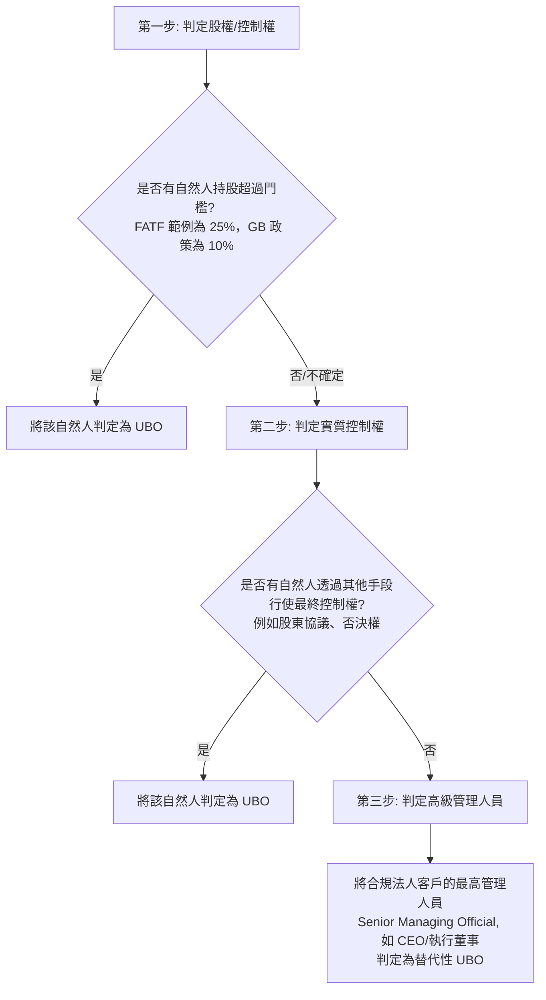

# 實質受益人 (Ultimate Beneficial Owner, UBO) 判定標準

實質受益人 (UBO) 是指最終直接或間接擁有或控制客戶實體的自然人，或代表其進行交易的自然人。在反洗錢/打擊資助恐怖主義 (AML/CFT) 合規框架中，識別與驗證 UBO 是防範法人洗錢、境外空殼公司 layering (分層架構) 的核心環節。

## 1. 核心法規要求

根據 **FATF 建議第 10 條** 與 **新加坡金融管理局 (MAS) Notice 626 第 6.13–6.14 段（詢問並識別）與第 6.14B 段（採取合理步驟驗證）**，金融機構必須識別並驗證 UBO：

- **控制股權閾值 (Controlling Ownership Interest)**：
  - **國際標準 (FATF)**：INR.10 註腳 40 說明控制股權可依門檻判定，並以 **超過 25%** 為例（e.g. 25%）。MAS Notice 626 本身只要求識別最終擁有或控制法人的自然人，沒有訂數字門檻；25% 的例子出現在另一份文件《Guidelines to MAS Notice 626》第 6-8-2 段，本專案沒有解析該文件。
  - **內部高風險防範標準 (Global Bank Policy)**：Global Bank 將此判定閾值收緊至 **10% (Shares/Voting Rights >= 10%)**，旨在對複雜股權結構進行更嚴密地穿透式審查。

## 2. UBO 判定三部曲 (順序判定原則)

金融機構在識別法人客戶的 UBO 時，應遵循以下遞進步驟：

1. **第一步：股權/表決權控制**：識別出通過直接或間接持有股權，達到控制性持股比例的自然人。
2. **第二步：實質控制權判定**：若無人滿足持股比例，但有自然人通過其他手段（例如特殊的股東合夥協議、表決權信託、重大決策否決權等）行使實質控制權，則判定為 UBO。
3. **第三步：高級管理人員替代判定**：如果採取前述步驟仍無法確定任何自然人，則必須將法人客戶中行使最高管理權限的自然人（如 CEO、執行總裁、董事會主席）列為替代性 UBO。

## 3. 溯源條款對照

條文 ID 對應 `data/gold/clauses.yaml`：

- **FATF Rec 10**：`fatf_rec10_rec_10_cdd_measures_b`（R.10 (b)）、`fatf_rec10_interpretive_note_to_rec_10_p_5_b_footnote_40`（INR.10 註腳 40，25% 範例）
- **MAS Notice 626**：`mas_notice_626_6_cdd_6_13`、`mas_notice_626_6_cdd_6_14`（第 6.13–6.14 段）、`mas_notice_626_6_cdd_6_14b`（第 6.14B 段，驗證）
- **Global Bank Policy**：`mock_internal_policy_s_1_customer_onboarding_standards_1_2_beneficial_ownership_verification_a`（第 1.2(a) 條，10% 門檻）
